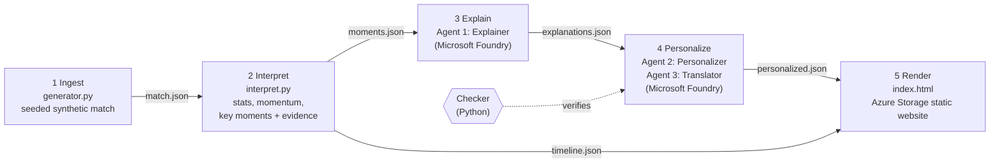

# Turning Points

**A synthetic match insights engine: it finds the moments a football match turned, explains *why* using evidence from the data, and tells the story differently for an analyst, a casual fan, a chosen player, and a second language.**

**Live demo:** https://turningpoints2026.z28.web.core.windows.net/
Built for the Microsoft x Premier League "Inside the Game" hackathon (Synthetic Match Insights Engine challenge). All clubs, players and match data are fictional and synthetic.

---

## Try it (about 1 minute)

1. Open the live demo link. It works on desktop and mobile; no sign-in.
2. The pitch graph shows who had the upper hand, minute by minute (bars above the line: Kazafani United; below: Magusa Athletic). Footballs are goals, arrows are momentum swings. Tap one to jump to its explanation.
3. Switch **Analyst / Casual fan**: same facts, different depth and vocabulary.
4. Switch **English / Türkçe**: every explanation and label changes language.
5. Pick a **Player focus** (e.g. Zeki Simitci): a stat strip computed from the match data, an AI "watch" note, and their moments highlighted.
6. Open **Evidence: the 5 minutes before** on any card to check the numbers in the text yourself.

## The problem

Match commentary tells you *what* happened. Fans and analysts want to know *why* the match turned, explained at their level and in their language. Generative AI writes fluent explanations, but fluent is not the same as true: models invent statistics. Turning Points only lets an explanation through if every number in it can be traced back to the match data.

## How it works

One pipeline, five stages, each a separate script that hands its output to the next as a JSON file:



| Stage | File | What it does |
|---|---|---|
| Ingest | `generator.py`, `teams.py`, `schema/events.py` | Generates a full 90-minute match (passes, shots with xG, tackles, pressing, goals) from a fixed random seed, validated against Pydantic event models. |
| Interpret | `interpret.py`, `export_timeline.py` | Computes pass completion, possession and a per-minute momentum score; detects key moments (goals, big chances, momentum swings); attaches the evidence for each: both teams' stats from the **five minutes before** the moment, never including the moment itself. |
| Explain | `explain.py` | **Explainer agent**: turns each moment and its evidence into a headline and a two-sentence explanation, under strict rules (facts only, no invented players or events, compare like with like). |
| Personalize | `personalize.py` | **Personalizer agent**: rewrites each explanation for an Analyst (tactical, 2–3 numbers) and a Casual fan (plain English, no jargon), and writes a "player to watch" note. **Translator agent**: translates everything into Turkish. |
| Render | `index.html` | A single HTML/JS page (no framework, hand-drawn SVG) that reads the JSON files. |

### Agent design and failure recovery

- Three agents with separate instructions, handing off through shared JSON state.
- **Checker (plain Python, no AI):** every number in AI-written text must appear in that moment's evidence; banned claims ("decisive", "winner", pressure "converted" into goals, "home/away") are rejected; word limits and jargon rules are enforced; translations must keep every number and name.
- **Recovery:** a rejected output is retried once; if it fails again, a template built from the data is used instead. Nothing unverified reaches the page.
- **Transparency:** every text is tagged `ai`, `ai+edited` (a human corrected the AI) or `fallback`, and the tag is shown on the page.

In the final run, all 20 outputs passed (one translation was rejected on its first attempt and passed on retry). A human review then corrected four Turkish texts where English words had been left untranslated; those are tagged `ai+edited`.

### Replay mode

The live site shows agent output that was generated in advance and saved, rather than calling the model on every page view. This keeps the demo free, instant and reliable for judges, and means every text on the page has been through the Checker and a human review. The page says so in its footer.

## Microsoft technologies

- **Microsoft Foundry:** a GPT-5-mini deployment (France Central) powers the Explainer, Personalizer and Translator agents through the Responses API (`azure-ai-projects` SDK).
- **Microsoft Entra ID:** authentication via `DefaultAzureCredential` (`az login`). There are no API keys in the code.
- **Azure Storage static website hosting** (France Central): serves the live site. *(Azure Static Web Apps was the original plan, but it is not available in the regions an Azure for Students subscription can use.)*
- **GitHub:** public repository.

## Run it yourself

Requirements: Python 3.12+ and, for the AI stages only, an Azure subscription with a Microsoft Foundry project and model deployment.

```bash
python -m venv .venv
.venv\Scripts\activate            # Windows (macOS/Linux: source .venv/bin/activate)
pip install -r requirements.txt

python generator.py               # 1  -> match.json (seed 3: always the same match)
python interpret.py               # 2  -> moments.json
python export_timeline.py         #    -> timeline.json (checks itself against moments.json)
# 3-4 call Microsoft Foundry: set ENDPOINT and MODEL at the top of each file, then `az login`
python explain.py                 # 3  -> explanations.json
python personalize.py --stats     #    player stat strips only, no AI calls
python personalize.py             # 4  -> personalized.json
python -m http.server 8000        # 5  -> open http://localhost:8000
```

The saved JSON files are already in the repository, so step 5 works on its own without Azure. Model wording varies between runs, so the AI outputs here are a saved snapshot; `personalize.py` refuses to overwrite `personalized.json` unless run with `--force`.

## The match

Kazafani United 2–3 Magusa Athletic: Kazafani lead 2–0 after 27 minutes; Magusa come back with goals at 47', 56' and 71'. Seven key moments: five goals and two momentum swings.

## Limitations

- One synthetic match; the generator is simplified (no fouls, substitutions or set pieces).
- Momentum is a simple weighted score of passes, shots (weighted by xG), pressing and tackles won.
- The Checker verifies numbers and names, not every possible wording; human review is still part of the process.

## Licence and data

All data is synthetic. All club and player names are fictional. No real clubs, players, logos or trademarks are used.
